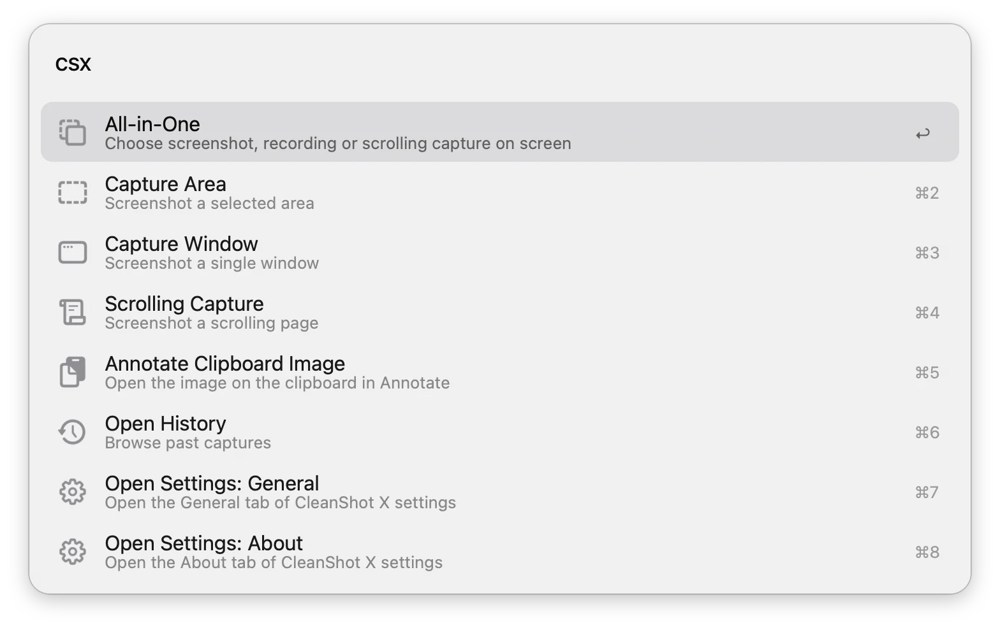
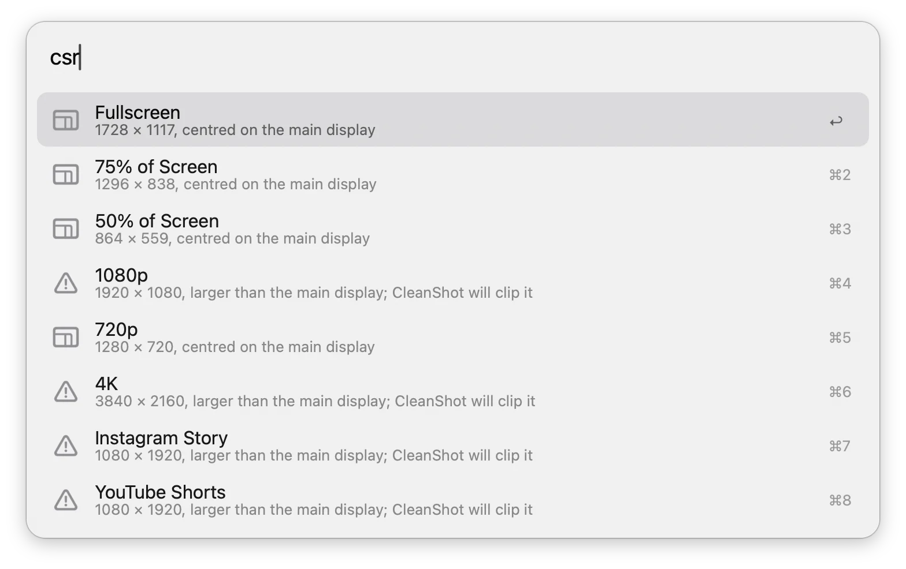

<a name="top"></a>

<p align="center">
  <a href="https://github.com/alwinsamson/cleanshot-x-workflow">
    
  </a>
</p>

<h1 align="center">CleanShot X for Alfred</h1>

<p align="center">
  Run CleanShot X screenshots, recordings, and tools from Alfred.
</p>

<p align="center">
  <a href="https://github.com/alwinsamson/cleanshot-x-workflow/issues/new?template=bug_report.yml">
    Report a Bug</a> ·
  <a href="https://github.com/alwinsamson/cleanshot-x-workflow/issues/new?template=feature_request.yml">
    Request a Feature</a>
</p>

<p align="center">
  <a href="#requirements">Requirements</a> ·
  <a href="#installation">Installation</a> ·
  <a href="#usage">Usage</a> ·
  <a href="#configuration">Configuration</a> ·
  <a href="#building-from-source">Building from source</a>
</p>

---

## Overview

This Alfred workflow controls [CleanShot X][cleanshot] through its URL scheme. It is
not affiliated with CleanShot X.

## Requirements

| Component   | Requirement                                   |
| ----------- | --------------------------------------------- |
| Alfred      | Alfred with the Powerpack. Tested with 6.0.3. |
| CleanShot X | Version 4.7 or later. Tested with 4.7.8.      |
| macOS       | Tested on macOS 26.                           |

## Installation

1. Download `CleanShotX.alfredworkflow` from the [latest release][releases].
2. Open the file. Alfred imports the workflow.

If another workflow uses the `cs`, `csx`, `csr`, or `csq` keyword, change the keyword
in [Configuration](#configuration).

## Usage

Type a command name in Alfred, for example `capture area`, `pin image`, or
`open settings recording`. You can also start with a later word of the name, for
example `area` or `recording`. Type `csx` or `cs` to list all commands.

<p align="center">
  
</p>

### After-capture actions

These keys apply to Capture Area, Capture Previous Area, Capture Fullscreen, Capture
Window, and Self-Timer.

| Key    | Action                                    |
| ------ | ----------------------------------------- |
| `↩`    | Use the CleanShot X after-capture setting |
| `⌘↩`   | Copy to the clipboard                     |
| `⌥↩`   | Save                                      |
| `⌃↩`   | Open in Annotate                          |
| `⇧↩`   | Upload to CleanShot Cloud                 |
| `fn↩`  | Pin to the screen                         |

### Files

Annotate Image, Pin Image, Add Quick Access Overlay, and Capture Text from Image use
the files selected in Finder. If no file is selected, Annotate and Pin ask you to
pick a file.

The same four commands are Alfred File Actions. Select a PNG or JPEG file in Alfred,
press `⇥`, and select the command. Add Quick Access Overlay also accepts MP4.

### Recording presets

Type `csr` to record at a preset size, centered on the main display. Type a size, for
example `csr 1440x900`, to record at that size once.

<p align="center">
  
</p>

Type `csq` to quit CleanShot X.

## Configuration

In Alfred Preferences, select the workflow and click **Configure Workflow**.

| Setting                  | Default       | Description                                   |
| ------------------------ | ------------- | --------------------------------------------- |
| Keyword                  | `csx` or `cs` | Lists all commands                            |
| Preset Keyword           | `csr`         | Records at a preset size                      |
| Quit Keyword             | `csq`         | Quits CleanShot X                             |
| Custom Recording Presets | Empty         | One preset per line, as `Name = WIDTHxHEIGHT` |

Example custom presets:

```text
Demo = 1600x1000
Square = 1080x1080
```

## Building from source

The build requires [jq][jq].

```sh
./build.sh
open dist/CleanShotX.alfredworkflow
```

`build.sh` generates `info.plist` from the command list in `src/cleanshot.js` and
packages the workflow in `dist/`. To redraw the SF Symbols command icons, run:

```sh
osascript -l JavaScript tools/make_icons.js "$PWD/assets"
```

## Acknowledgements

- [CleanShot X API][api] - URL scheme that the workflow uses.

## License

CleanShot X for Alfred is available under the BSD 3-Clause license. See
[LICENSE](LICENSE) for details.

---

<p align="right">
  <a href="#top">Back to top</a>
</p>

[cleanshot]: https://cleanshot.com
[releases]: https://github.com/alwinsamson/cleanshot-x-workflow/releases/latest
[jq]: https://jqlang.org
[api]: https://cleanshot.com/docs-api
